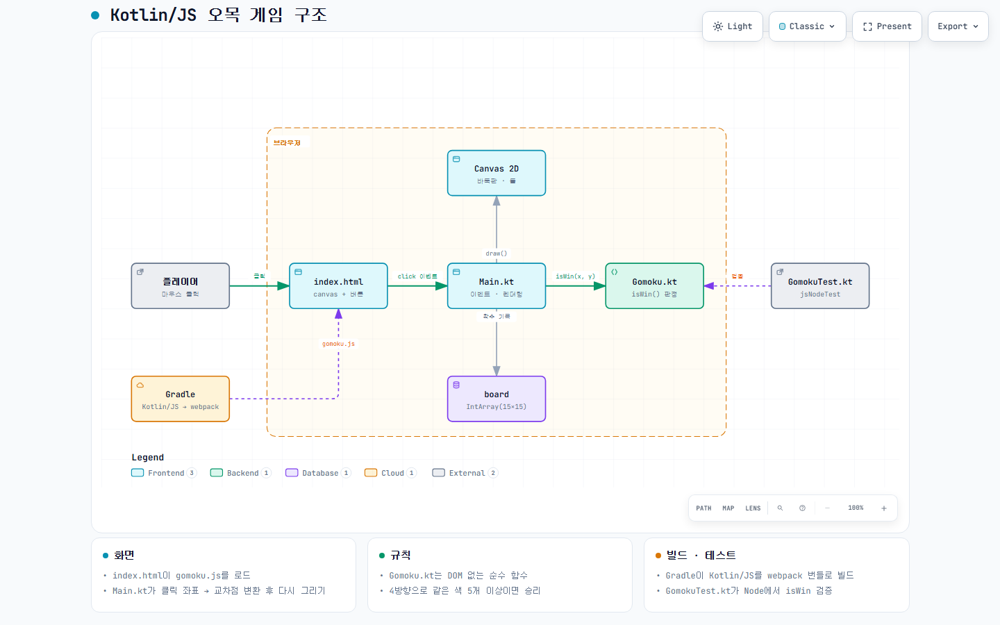

# 오목 (Kotlin/JS)

Kotlin/JS로 만든 브라우저용 2인 오목 게임입니다. 15×15 바둑판에서 흑이 먼저 두고, 가로·세로·대각선으로 같은 색 돌 5개 이상을 먼저 이으면 승리합니다.

## 실행

| 목적 | 명령 | IntelliJ 실행 구성 |
|---|---|---|
| 게임 실행 (개발 서버 + 브라우저) | `./gradlew jsBrowserDevelopmentRun` | `게임 실행` |
| 테스트 | `./gradlew jsNodeTest` | `테스트` |
| 배포용 빌드 | `./gradlew jsBrowserDistribution` | – |

배포용 빌드 결과는 `build/dist/js/productionExecutable/`에 생기며, `index.html`을 열면 바로 플레이할 수 있습니다.
필요한 것은 JDK 17뿐입니다. Gradle·Node.js·webpack은 Gradle 래퍼와 Kotlin 플러그인이 자동으로 내려받습니다.

IntelliJ에서는 프로젝트 폴더를 열고 Gradle 동기화가 끝나면, 오른쪽 위 드롭다운에서 실행 구성을 골라 ▶를 누르면 됩니다.

## 구조



인터랙티브 버전은 [`docs/architecture.html`](docs/architecture.html)을 내려받아 브라우저로 여세요. 원본 명세는 `docs/architecture.json`이고 [archify](https://github.com/tt-a1i/archify)로 그렸습니다.

```
.
├── build.gradle.kts              # Kotlin Multiplatform (js: browser + nodejs)
├── settings.gradle.kts
├── src/
│   ├── jsMain/
│   │   ├── kotlin/
│   │   │   ├── Gomoku.kt         # 승리 판정 (순수 로직)
│   │   │   └── Main.kt           # 화면 그리기 · 클릭 처리
│   │   └── resources/
│   │       └── index.html        # 페이지 (canvas, 상태 표시, 다시 시작 버튼)
│   └── jsTest/kotlin/
│       └── GomokuTest.kt         # 승리 판정 테스트
├── .run/                         # IntelliJ 실행 구성 (게임 실행 / 테스트)
├── kotlin-js-store/yarn.lock     # npm 의존성 고정
└── docs/                         # 구조도
```

## 코드 설명

### `Gomoku.kt` — 규칙

```kotlin
const val N = 15
fun isWin(board: IntArray, x: Int, y: Int): Boolean
```

- 바둑판은 길이 `15 × 15`인 1차원 `IntArray`이고, 칸 `(x, y)`는 `board[y * N + x]`입니다. 값은 `0` 빈칸, `1` 흑, `2` 백입니다.
- `isWin`은 **방금 둔 돌** 하나만 기준으로 검사합니다. 4방향(가로 `1,0`, 세로 `0,1`, 대각 `1,1`, 역대각 `1,-1`) 각각에 대해 양쪽(`+1`, `-1`)으로 같은 색이 이어지는 만큼 세고, 합이 5 이상이면 승리입니다.
- 매 착수마다 판 전체를 훑지 않으므로 한 번의 판정은 최대 4방향 × 14칸입니다.
- `cx in 0 until N` 범위 검사 덕분에 줄 끝에서 다음 줄로 넘어가 이어진 것처럼 세는 일이 없습니다.
- DOM에 의존하지 않는 순수 함수라서 Node 환경에서 바로 테스트할 수 있습니다.

### `Main.kt` — 화면과 입력

| 이름 | 역할 |
|---|---|
| `board`, `turn`, `last`, `over` | 게임 상태 (바둑판, 현재 차례 `1`/`2`, 마지막 착수 위치, 종료 여부) |
| `CELL = 36.0` | 교차점 간격(px). 캔버스 크기는 `CELL × (N + 1)` = 576px |
| `pos(i)` | 바둑판 인덱스 → 캔버스 좌표 (`CELL × (i + 1)`, 가장자리 여백 1칸) |
| `draw()` | 나무색 배경 → 격자선 → 화점 9개 → 돌 → 마지막 수 빨간 점 → 상태 문구 순으로 전체를 다시 그림 |
| `reset()` | 상태를 초기화하고 다시 그림 ("다시 시작" 버튼) |
| `main()` | 캔버스 크기 설정, 클릭·버튼 이벤트 등록, 첫 화면 그리기 |

클릭 처리 흐름:

1. 클릭 좌표를 `getBoundingClientRect()` 기준으로 바꾸고, 화면에 맞게 줄어든 캔버스(`max-width: 100%`)를 고려해 `scale`을 곱합니다.
2. `CELL`로 나눈 뒤 반올림해 **가장 가까운 교차점** `(x, y)`를 구합니다.
3. 판 밖이거나 이미 돌이 있으면 무시합니다.
4. 돌을 놓고 `isWin`으로 판정합니다. 이겼으면 `over = true`, 아니면 `turn = 3 - turn`으로 차례를 바꿉니다 (1 ↔ 2).
5. `draw()`로 다시 그립니다.

### `index.html`

`<canvas id="board">`, 상태 문구 `#status`, `#reset` 버튼만 있는 페이지입니다. Kotlin이 컴파일된 `gomoku.js`(파일명은 `settings.gradle.kts`의 `rootProject.name`에서 옴)를 로드합니다.

### `GomokuTest.kt`

`isWin`을 다음 경우로 검증합니다: 가로 5목, 대각 5목, 역대각 5목, 4목(승리 아님), 줄 끝에서 다음 줄로 넘어가는 배치(승리 아님).

### 빌드 설정 (`build.gradle.kts`)

- Kotlin Multiplatform 플러그인 2.1.0, `js` 타깃 하나에 `browser()`(webpack 번들)와 `nodejs()`(테스트용)를 함께 켰습니다.
- 브라우저 테스트(Karma)는 꺼 두었습니다. 테스트할 브라우저가 설정돼 있지 않으면 아무것도 실행하지 않고 성공으로 표시되기 때문입니다. 테스트는 Node에서만 돌립니다.

## 안 넣은 것

AI 상대, 렌주룰(흑 3-3·4-4·장목 금수), 무르기, 온라인 대전은 없습니다.
